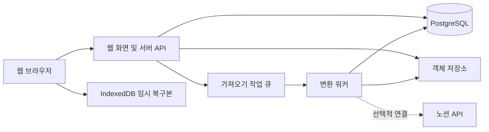

# Yotion 기획·설계·개발 실행 계획

작성일: 2026-10-26 / 상태: 개발 착수를 위한 초안

## 1. 프로젝트 정의

노션의 사용자 경험과 문서 교환 방식을 리버스 엔지니어링하여, 자체 프런트엔드·서버·DB에서 운영하는 독립 웹앱을 개발한다. 문서를 생성·편집·저장하는 핵심 기능은 노션 계정이나 노션 API에 의존하지 않는다.

노션과 유사한 UI와 동작을 목표로 한다. 기능별 관찰 결과를 명세로 만들고 자체 코드로 구현한다. 노션 문서를 가져오는 기능은 독립적인 변환 모듈로 개발한다.

이 문서의 REA는 reverse engineering을 뜻하며 특정 프레임워크나 제품을 뜻하지 않는다.

### 기본 가정

- 첫 사용자는 한국어로 문서를 작성하는 개인 사용자다.
- 초기 개발 환경은 Windows, 우선 지원 환경은 데스크톱 Chrome·Edge다.
- 계정·워크스페이스 구조를 갖추되, 첫 출시에서는 개인 작업 공간을 우선한다.
- 반응형 읽기 화면은 제공하되 모바일 편집의 노션 수준 재현은 후속 범위다.
- 공개 배포 전까지 외부 서비스 구매나 실제 사용자 데이터 이전은 별도로 실행하지 않는다.
- 기술 선택과 일정은 제안이다. 프로토타입 결과에 따라 문서를 갱신한다.

## 2. 사용자 시나리오와 성공 조건

| 시나리오 | 기대 결과 |
|---|---|
| 문서를 새로 작성한다 | 페이지 생성 후 즉시 입력하고 새로고침해도 저장된 내용이 유지된다 |
| 긴 글을 구성한다 | 제목·목록·토글·이미지·코드를 삽입하고 블록 순서를 바꾼다 |
| 문서를 정리한다 | 하위 페이지 생성, 페이지 이동, 즐겨찾기, 검색을 사용한다 |
| 노션 글을 가져온다 | 지원되는 내용을 변환하고 누락·변형 항목을 확인한다 |
| 자료를 다른 곳으로 옮긴다 | 자체 백업과 Markdown·HTML 내보내기로 데이터를 확보한다 |
| 표로 업무를 관리한다 | 후속 단계에서 속성·행·뷰를 가진 데이터베이스를 사용한다 |

독립성 완료 조건: 노션 연결을 전혀 설정하지 않은 신규 환경에서도 가입, 페이지 생성, 편집, 저장, 검색, 백업 복원이 동작한다.

## 3. 범위와 출시 구분

### 문서 MVP

- 계정, 개인 워크스페이스, 페이지 트리, 즐겨찾기, 휴지통·복원.
- 제목·아이콘·커버, 넓은 본문, 라이트·다크 테마.
- 문단, 제목 1~3, 글머리·번호 목록, 체크박스, 토글, 인용, 구분선.
- 굵게·기울임·밑줄·취소선·인라인 코드·링크·색상.
- 코드 블록, 이미지·첨부파일, 단순 표. 단순 표와 데이터베이스는 구분한다.
- `/` 명령, 블록 메뉴, 드래그 정렬, 들여쓰기, 복사·붙여넣기, 실행 취소·재실행.
- 자동 저장 상태, 저장 실패 재시도, 충돌 알림, 임시 복구본.
- 제목·본문 검색, Markdown·HTML 가져오기, 자체 백업·복원.
- 노션 Markdown·CSV ZIP 중 문서와 첨부파일 가져오기. CSV 데이터베이스 변환은 다음 단계다.
- 외부 드래그는 실험 결과로 확인된 형식부터 지원하고 미지원 입력은 설명한다.

### 데이터베이스 확장

- 행을 페이지로 취급하고 제목·텍스트·숫자·체크박스·선택·다중선택·날짜·URL 속성을 지원한다.
- 표 → 보드 → 캘린더 순서로 뷰를 추가하고 필터·정렬·열 표시 설정을 저장한다.
- CSV 가져오기와 내보내기를 제공한다.
- 관계형 → 롤업 → 수식 순서로 확장한다. 수식은 지원 함수·타입·오류 규칙을 별도로 명세한다.
- 노션의 수식 계산과 완전히 같은 결과를 내는 것은 별도 호환성 과제로 관리한다.

### 후속 기능

실시간 공동 편집, 댓글·멘션, 공유 권한, 공개 페이지, API 연결 가져오기·내보내기, 선택적 양방향 동기화, 오프라인 편집, 모바일 편집을 순차 검토한다.

Notion AI, 자동화, 외부 서비스 커넥터, 전체 변경 이력 이전, 워크스페이스 권한의 완전 복제는 초기 범위에 포함하지 않는다. 최종 기능 동등성은 이 항목들도 각각 구현·검증해야 달성된다.

## 4. 리버스 엔지니어링 절차

### 조사 대상과 방법

사용자가 접근 권한을 가진 테스트 워크스페이스에서 동작을 관찰한다. 공개 문서, 브라우저 화면, 직접 만든 테스트 문서, 내보내기 결과, 브라우저가 드롭·붙여넣기 이벤트로 제공하는 데이터를 조사 자료로 사용한다.

노션 내부 소스 코드를 확보하는 것을 전제로 하지 않는다. 비공개 API를 제품의 핵심 의존성으로 삼지 않으며 접근 통제 우회나 타인의 데이터 수집은 조사 범위에 없다. 제품 코드·로고·브랜드 자산을 복사하지 않고 자체 구현·자체 자산을 사용한다.

### 기능별 관찰 기록

각 기능을 다음 형식으로 기록한다.

| 필드 | 기록 내용 |
|---|---|
| 기능 ID | 예: EDIT-014 |
| 환경 | 관찰일, OS, 브라우저 또는 데스크톱 앱 버전 |
| 초기 상태 | 페이지 구조, 선택 범위, 커서 위치 |
| 입력 | 키 입력, 클릭, 드래그 시작점·종료점 |
| 결과 | 화면·문서 구조·포커스·실행 취소 결과 |
| 예외 | 빈 블록, 중첩 구조, 긴 글, 한글 조합 중 입력 |
| 근거 | 테스트 문서, 스크린샷, 재현 절차 |
| 구현 결정 | 동일 구현 / 유사 구현 / 보류와 이유 |

### 우선 조사 순서

1. Enter·Backspace·Delete·Tab·Shift+Tab과 방향키의 동작.
2. 한글 IME 조합 중 메뉴·저장·단축키가 작동하는 조건.
3. 여러 블록 선택, 복제, 이동, 들여쓰기, 삭제, 실행 취소.
4. 사이드바 페이지 이동, 하위 페이지, 휴지통 복원.
5. 외부 드래그·클립보드·내보내기 파일의 실제 데이터.
6. 단순 표와 데이터베이스의 차이, 속성·뷰의 저장 규칙.

관찰 → 명세 작성 → 자체 구현 → 동일 입력으로 비교 → 차이 기록 순서를 반복한다. UI만 비슷하고 키보드 동작이 다른 상태는 완료로 처리하지 않는다.

## 5. 호환성 설계

### 입력 경로

| 경로 | 처리 방식 | 한계와 검증 |
|---|---|---|
| 텍스트·HTML 드래그/붙여넣기 | 브라우저 제공 데이터를 정제해 내부 블록으로 변환 | 실제 전달 형식을 먼저 측정하며 전체 페이지 정보가 있다고 가정하지 않는다 |
| 파일·ZIP 드롭 | 파일 형식 판별 → 분석 → 미리보기 → 가져오기 | 첨부파일·상대 링크·중첩 폴더·중복 파일을 검증한다 |
| 노션 페이지 링크 드롭 | 링크로 인식하고 파일 가져오기 또는 선택적 API 연결을 안내 | 링크 자체는 비공개 문서 접근 권한을 제공하지 않는다 |
| 노션 API 연결 | 권한이 부여된 페이지·블록을 변환 | 초기 필수 조건이 아니며 지원 유형별로 구현한다 |
| 자체 JSON 백업 | 버전이 명시된 자체 형식으로 복원 | 자체 데이터의 충실한 복원 기준이며 노션 전용 형식이 아니다 |

가져오기 기본 동작은 복사다. 노션 원본은 삭제하지 않는다. 원본 삭제를 포함한 이동은 추후 별도 기능으로 다룬다.

### 변환 파이프라인

입력 식별 → 안전성·크기 검사 → 중간 문서 모델 생성 → 원본 ID와 새 ID 매핑 → 페이지·파일 생성 → 내부 링크 재연결 → 결과 검증 → 완료 보고.

- 반복 가져오기 시 중복 정책을 선택할 수 있게 한다. 기본값은 새 사본 생성이다.
- 작업 ID와 재시도 키를 사용해 같은 작업의 중복 실행을 막는다.
- 미지원 블록은 가능한 경우 원문·첨부·출처와 함께 대체 블록으로 보존한다.
- 복원 불가능한 내용은 조용히 버리지 않고 보고서에 기록한다.
- 외부 이미지 주소는 만료·권한 문제가 있을 수 있으므로 수집 가능한 파일만 자체 저장소로 복사한다.
- 관계형 데이터는 모든 대상 페이지 생성 후 두 번째 단계에서 연결한다.
- 대용량 가져오기는 임시 영역에 저장하고 검증 성공 후 사용자에게 노출한다. 실패 시 생성한 데이터만 정리한다.

### 호환성 등급

| 등급 | 의미 |
|---|---|
| A | 내용·구조·지원 서식이 검증 기준과 일치 |
| B | 내용은 유지되나 서식 또는 동작 일부 변경 |
| C | 대체 블록·첨부·원문으로만 보존 |
| D | 가져오기 불가, 원인과 해결 경로 제시 |

블록 종류별·입력 경로별로 등급을 기록한다. 숫자 하나로 '99% 호환'이라고 표시하지 않는다. 자체 JSON의 복원, 노션에서의 가져오기, 노션으로의 재전송은 서로 다른 시험이다.

공식 내보내기는 워크스페이스 전체 상태의 무손실 복원 수단이 아니다. 노션은 내보낸 내용을 재업로드해 즉시 워크스페이스를 재현할 수 없다고 안내한다. 관계형 CSV의 관계 복원에도 제약이 있다. [내보내기 문서](https://www.notion.com/help/export-your-content), [관계형 문서](https://www.notion.com/en-gb/help/relations-and-rollups)

## 6. UX와 화면 설계

| 화면 | 구성과 핵심 동작 |
|---|---|
| 작업 화면 | 좌측 트리·검색·즐겨찾기, 상단 경로·저장 상태, 중앙 문서 |
| 문서 편집 | 아이콘·커버·제목, 블록 핸들, 삽입 메뉴, 선택 도구 |
| 검색 | 키보드 탐색 가능한 결과 목록과 문서 이동 |
| 가져오기 | 파일·드롭 영역, 지원 범위, 분석 결과, 실행·진행·결과 보고 |
| 데이터베이스 | 뷰 탭, 속성, 필터·정렬, 행 상세 페이지 |
| 설정·휴지통 | 테마, 백업, 보관 기간, 삭제·복원 |

화면 분석 시 너비, 여백, 글꼴, 행간, 색상, hover·focus·선택·빈 상태를 토큰으로 기록한다. 고정한 브라우저·화면 크기에서 비교하며 캡처 날짜를 남긴다. 목표는 노션과 매우 유사한 사용 경험이며 픽셀 단위 일치는 해당 기준 환경에서 별도 검증한다.

키보드로 메뉴 선택·닫기·블록 이동이 가능해야 한다. 드래그에만 의존하지 않는다. 한글 조합 중 Enter가 문단 분리로 잘못 처리되거나 저장 후 조합 문자가 사라지지 않아야 한다.

## 7. 기술 설계 제안

### 기본 구성

| 영역 | 제안 | 선택 이유·검증 사항 |
|---|---|---|
| 프런트엔드·웹 서버 | Next.js + React + TypeScript | 화면과 서버 경계를 한 프로젝트에서 관리한다 |
| 편집 엔진 | Tiptap / ProseMirror | 구조화된 문서·명령·확장 기반으로 블록 동작을 구현한다 |
| 스타일 | CSS 변수와 재사용 컴포넌트 | 노션 관찰 결과를 디자인 토큰으로 관리한다 |
| 영구 데이터 | PostgreSQL + 마이그레이션 도구 | 페이지 계층·속성·권한·트랜잭션을 관리한다 |
| 파일 | S3 호환 객체 저장소 | 문서 데이터와 첨부파일 저장을 분리한다 |
| 로컬 복구 | IndexedDB | 서버 저장 전 임시본과 실패한 저장 작업을 보관한다 |
| 가져오기 처리 | 별도 Node.js 워커 + PostgreSQL 작업 큐 | HTTP 요청 수명과 무관하게 장시간 작업을 처리한다 |
| 검증 | Vitest + Playwright | 변환·문서 규칙과 실제 사용자 흐름을 검증한다 |
| 협업 확장 | Yjs 기반 별도 설계 | 동시 편집 도입 시 문서 저장 모델과 함께 전환한다 |

위 선택은 아직 설치·성능 검증하지 않은 제안이다. 프로토타입에서 목록·토글 중첩, 안정적인 블록 ID, 다중 블록 이동, 한글 IME를 먼저 확인한다. 기본 확장만으로 노션의 모든 동작이 구현된다고 가정하지 않는다.

Tiptap은 노드·마크·확장으로 편집기를 구성한다. 사용할 각 확장의 오픈소스/유료 범위와 라이선스는 의존성 확정 시 확인하고 잠금 파일에 버전을 고정한다. [Tiptap 공식 문서](https://tiptap.dev/docs/editor/core-concepts/introduction)

Yjs는 공동 편집용 공유 데이터와 CRDT를 제공한다. 도입만으로 권한·저장·백업·관계형 데이터 충돌이 해결되는 것은 아니다. [Yjs 공식 문서](https://docs.yjs.dev/)

### 구성 관계

### 문서 모델과 저장 원칙

MVP는 페이지별로 버전이 있는 편집기 JSON을 원본으로 저장한다. 각 블록 노드에는 안정적인 ID를 부여한다. 검색용 텍스트와 호환성 분석 결과는 파생 데이터로 관리한다. 별도의 blocks 테이블과 JSON을 동시에 원본으로 사용하지 않는다.

대형 문서에서 페이지 전체 저장이 병목이면 측정 후 블록 단위 저장을 검토한다. 실시간 협업 도입 시에는 Yjs 상태를 원본으로 전환하고 JSON은 내보내기·검색용 스냅샷으로 만든다. 기존 JSON과 협업 상태를 독립적으로 수정하지 않는다.

| 엔터티 | 주요 필드 |
|---|---|
| users | id, 인증 제공자 식별자, 표시 이름 |
| workspaces / memberships | id, 사용자, 역할 |
| pages | id, workspace_id, parent_id, title, icon, cover, order_key, deleted_at |
| page_documents | page_id, schema_version, revision, content_json, updated_at |
| page_revisions | page_id, revision, snapshot_ref, created_at |
| files | id, workspace_id, storage_key, mime, size, checksum |
| collections / properties | DB 정의, 속성 타입·설정 |
| records / property_values | 행 페이지, 타입별 값 |
| views | collection_id, type, filter, sort, configuration |
| import_jobs / import_mappings | 상태, 진행률, 오류, 원본 ID와 내부 ID 매핑 |

페이지 부모 변경 시 순환 구조를 막는다. 모든 문서·파일·작업 조회에는 워크스페이스 권한 검사를 적용한다. 정렬 키는 중간 삽입을 지원하고 필요 시 재정렬한다.

### 주요 API 계약

- 페이지: 생성·목록·메타데이터 변경·이동·휴지통·복원.
- 문서: 조회, revision 조건부 저장, 충돌 응답, 복구본 조회.
- 파일: 업로드 권한 발급·완료 확인·접근 권한 검사.
- 가져오기: 작업 생성·미리보기·시작·상태·실패 보고서·취소.
- 내보내기: 작업 생성·상태·유효기간이 있는 다운로드.
- DB 확장: 스키마 변경·행 CRUD·뷰별 조회.

revision이 다른 저장은 충돌로 응답하고 이전 내용을 덮어쓰지 않는다. 저장 UI는 편집 중·저장 중·저장 완료·오프라인·실패를 구분한다. 서버 확인 전에는 저장 완료를 표시하지 않는다.

## 8. 보안·운영 설계

- 인증은 검증된 라이브러리를 사용하고 쿠키·세션·요청 검증을 적용한다.
- HTML 가져오기와 링크는 허용 목록으로 정제하고 스크립트 실행을 차단한다.
- ZIP 경로 이탈, 압축 폭탄, 파일 크기·개수 초과를 검사한다.
- 원격 파일 다운로드는 사설망·메타데이터 주소 접근과 우회 리디렉션을 차단한다.
- 워커는 제한된 메모리·시간·재시도 횟수로 실행한다.
- API 비밀키는 서버에 보관하며 로그·클라이언트 번들에 포함하지 않는다.
- 문서 본문·인증정보를 일반 오류 로그에 기록하지 않는다.
- DB와 첨부파일을 함께 백업하고 실제 복원 시험으로 검증한다.
- 초기 운영 정책 제안: 일일 백업, 30일 보관, 출시 전 복원 시간 측정. 실제 보관 정책과 비용은 배포 환경 선정 시 확정한다.
- 웹·워커·DB 마이그레이션을 구분해 배포하고, 스키마 변경 전 백업과 이전 버전 호환성을 확인한다.

## 9. 개발 단계와 산출물

아래 일정은 숙련 개발자 1명이 주로 전담한다는 가정의 계획 범위다. 확정 견적이 아니며 검증 실패·설계 변경·협업 기능 추가에 따라 늘어난다. 각 단계의 완료 조건을 충족한 뒤 다음 단계로 진행한다.

| 단계 | 예상 기간 | 주요 작업 | 산출물·완료 조건 |
|---|---|---|---|
| 0. 기획 확정 | 1주 | 사용자 흐름·MVP·지원 환경 정리 | 기능 목록·화면 지도·범위 기준선 |
| 1. REA·기술 검증 | 1~2주 | 동작 관찰, 드롭 분석, 편집 엔진 실험 | 관찰 명세·호환성 표·기술 결정 기록 |
| 2. 기반·UI | 1~2주 | 프로젝트, 인증, DB, 화면 틀·트리 | 독립 실행·페이지 생성·권한 분리 |
| 3. 편집기 | 3~5주 | 블록·키보드·IME·드래그·저장 | 기본 문서 흐름과 데이터 보존 시험 통과 |
| 4. 이전·검색·복구 | 2~3주 | ZIP·파일 변환, 검색, 백업·복원 | 누락 보고서와 자체 백업 복원 확인 |
| 5. 안정화·문서 MVP | 1~2주 | 성능·보안·실사용 검증·배포 절차 | 출시 체크리스트 통과 |
| 6. 데이터베이스 | 추가 4~8주 | 타입·행·뷰·CSV, 관계형·수식 실험 | 지원 범위별 시험과 별도 출시 |
| 7. 협업·고급 호환 | 별도 산정 | 권한·CRDT·API 연동·동기화 | 별도 설계·견적·출시 기준 |

문서 MVP의 초기 계획 범위는 약 9~15주다. 데이터베이스 확장은 누적 약 13~23주이며 복잡한 수식 동등성·협업·양방향 동기화 기간은 포함하지 않는다. AI 보조 도구 사용만을 근거로 이 기간을 단축 확약하지 않는다.

## 10. 검증 전략과 출시 기준

### 테스트 자료

직접 작성한 최소 30개 문서로 제목·목록·토글·중첩·이미지·코드·표·한글·특수문자·빈 문서·긴 문서를 구성한다. DB 단계에는 관계·롤업·수식·필터별 자료를 추가한다. 외부 실제 사용자 문서는 허용된 경우에만 별도로 사용한다.

### 필수 검증

- 입력과 저장: 한글 조합, 빠른 입력, 실행 취소, 이미지 업로드 후 새로고침.
- 장애: 네트워크 단절·재연결, 저장 실패·재시도, 탭 두 개에서 같은 문서 수정.
- 구조: 페이지 이동 후 링크·하위 페이지 보존, 순환 부모 차단, 휴지통 복원.
- 변환: 지원 블록의 텍스트·서식·순서·계층·첨부·내부 링크 비교.
- 백업: 새 환경에 DB·파일 복원 후 문서 수·내용·파일 체크섬 비교.
- 보안: 타 워크스페이스 ID 접근, 위험 HTML·ZIP·원격 URL 입력.
- UX: 키보드 탐색·포커스·읽기 대비, 고정 환경의 화면 비교.

### 초기 성능 목표

개발 검증 기준 장비·브라우저·네트워크를 결과와 함께 기록한다. 아래 값은 측정 전 목표이며 보장 수치가 아니다.

- 텍스트 위주 1,000블록 문서에서 입력 반영 지연 p95 100ms 이내.
- 같은 문서 첫 편집 가능 상태 2초 이내를 목표로 측정한다.
- 정상 연결 시 마지막 입력 이후 2초 이내 저장 완료 확인.
- 10,000페이지 자료에서 제목 검색 p95 500ms 이내를 목표로 측정한다.
- 본문 검색은 한국어 토큰화 품질을 별도 평가하고 필요할 때 전용 검색 엔진을 도입한다.

### 출시 차단 조건

지원 범위의 문서가 조용히 유실되는 문제, 권한 우회, 재현 가능한 저장 충돌 덮어쓰기, 백업 복원 실패가 남아 있으면 출시하지 않는다. 미지원 기능은 화면·문서에 명시하고 가져오기 결과에서도 식별할 수 있어야 한다.

## 11. 변경·의사결정 관리

새 요구는 요구사항 ID·사용자 가치·범위·완료 기준을 기록한다. 범위가 늘면 일정과 호환성 표를 함께 수정한다. 매 단계마다 사용 가능한 결과물을 검토하고 다음 단계를 구체화한다.

기술 결정 기록은 문제, 비교한 대안, 선택, 근거, 되돌릴 조건을 포함한다. 초기 결정 대상은 편집기 모델, 저장 단위, 외부 드래그 범위, 인증 방식, 검색, 배포 환경이다.

운영 비용은 웹 서버·DB·파일 용량·전송량·워커·메일·백업으로 분리해 산정한다. 실제 사용자 수와 저장량이 정해지기 전에는 월 비용을 확약하지 않는다.

## 12. 개발 착수 순서

1. 현재 문서를 기준선으로 두고 REA 관찰 템플릿·테스트 문서를 만든다.
2. 드래그·붙여넣기 데이터 관찰용 로컬 실험 화면을 만든다.
3. Tiptap으로 한글 입력·중첩 블록·블록 ID·이동·저장 실험을 한다.
4. 실험 결과로 지원 범위를 확정하고 프로젝트 골격·DB 마이그레이션을 만든다.
5. 페이지 생성 → 입력 → 저장 → 새로고침 복원 흐름을 먼저 완성한다.
6. 편집 기능과 노션 유사 UI를 점진적으로 확장한다.
7. 가져오기·검색·백업·복원 후 출시 기준을 검증한다.

이 문서는 기획·실행 계획의 기준선이다. 2026-10-26에 첫 로컬 프로토타입(입력 관찰 화면·Tiptap 최소 편집기)과 로컬 문서 작업 공간을 구현했다. [작업 화면 구현·검증](작업화면.md)과 [첫 개발 묶음 시험 절차](observations/첫-개발-묶음.md)를 별도 관리한다. 실제 노션 호환성 시험과 한글 IME 수동 검증은 아직 수행하지 않았다.

## 참고 자료

2026-10-26 확인. 외부 API·라이브러리 지원 범위는 해당 기능 구현 직전에 재확인한다.

- [Notion Block API](https://developers.notion.com/reference/block): 블록별 지원 구조와 미지원 유형 확인.
- [Notion Create a view](https://developers.notion.com/reference/create-view): 현재 공식 뷰 API가 존재하므로 '뷰 API 없음'을 전제로 설계하지 않는다.
- [Notion 내보내기](https://www.notion.com/help/export-your-content): 파일 기반 이전의 범위와 복원 제약.
- [Notion 관계형·롤업](https://www.notion.com/en-gb/help/relations-and-rollups): CSV 관계 보존 제약.
- [Tiptap 개념](https://tiptap.dev/docs/editor/core-concepts/introduction): 편집기 확장 모델.
- [Yjs 문서](https://docs.yjs.dev/): 후속 공동 편집 기술 검토.
